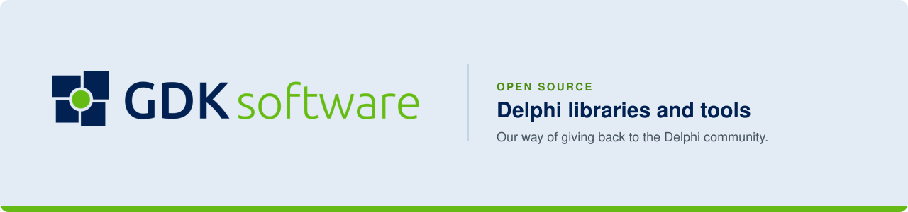
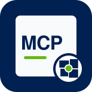
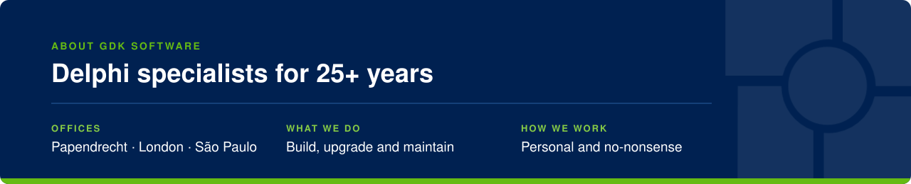

<picture>
  <source media="(prefers-color-scheme: dark)" srcset="assets/banner-dark.svg">
  
</picture>

<table>
  <tr>
    <td width="33%" valign="top">
      
      <h3><a href="https://github.com/GDKsoftware/Delphi-MCP-Server">Delphi-MCP-Server</a></h3>
      Let Claude and other AI assistants call into your Delphi code. A native implementation of the Model Context Protocol.  
      
    </td>
    <td width="33%" valign="top">
      
      <h3><a href="https://github.com/GDKsoftware/OfficeXML4D">Office4D</a></h3>
      Read and write Word, Excel and PowerPoint documents from Delphi, without Microsoft Office installed.  
      
    </td>
    <td width="33%" valign="top">
      
      <h3><a href="https://github.com/GDKsoftware/Markdown4D">Markdown4D</a></h3>
      A CommonMark/GFM parser with a public AST, plus a VCL &amp; FMX viewer and editor.  
      
    </td>
  </tr>
</table>

### More libraries

<table>
  <tr>
    <td width="190" valign="top"><a href="https://github.com/GDKsoftware/Pdf4D"><b>Pdf4D</b></a></td>
    <td valign="top">Read PDF documents: pages, outlines, form fields, attachments and text extraction. A native port of Apache PDFBox</td>
  </tr>
  <tr>
    <td width="190" valign="top"><a href="https://github.com/GDKsoftware/Chart4D"><b>Chart4D</b></a></td>
    <td valign="top">Publication-ready charts for VCL and FMX with clean newspaper-style defaults and PNG export</td>
  </tr>
  <tr>
    <td width="190" valign="top"><a href="https://github.com/GDKsoftware/Microsoft365-4D"><b>Microsoft365-4D</b></a></td>
    <td valign="top">Mail, Calendar, Contacts and SharePoint via the Graph API, with OAuth2 and PKCE</td>
  </tr>
  <tr>
    <td width="190" valign="top"><a href="https://github.com/GDKsoftware/Javascript4D"><b>Javascript4D</b></a></td>
    <td valign="top">JavaScript parser and interpreter: ECMAScript 5.1 plus ES2015+ features such as classes, promises and generators</td>
  </tr>
</table>

### MCP &amp; AI

Connect your Delphi applications and data to Claude and other AI assistants through the Model Context Protocol.

<table>
  <tr>
    <td width="190" valign="top"><a href="https://github.com/GDKsoftware/MCPAuth4D"><b>MCPAuth4D</b></a></td>
    <td valign="top">Central OAuth server and client with linked upstream accounts, so you can connect your Delphi MCP servers to Claude</td>
  </tr>
  <tr>
    <td width="190" valign="top"><a href="https://github.com/GDKsoftware/MicrosoftMCP"><b>MicrosoftMCP</b></a></td>
    <td valign="top">Microsoft 365 MCP server with multiple mailboxes per user</td>
  </tr>
  <tr>
    <td width="190" valign="top"><a href="https://github.com/GDKsoftware/Toon4D"><b>Toon4D</b></a></td>
    <td valign="top">JSON to TOON encoder: 30-60% token reduction for LLM prompts</td>
  </tr>
</table>

### Developer tools and utilities

<table>
  <tr>
    <td width="190" valign="top"><a href="https://github.com/GDKsoftware/ToolsAPI-helper"><b>ToolsAPI-helper</b></a></td>
    <td valign="top">Helpers and classes that make building your own Delphi IDE extensions with the ToolsAPI much easier</td>
  </tr>
  <tr>
    <td width="190" valign="top"><a href="https://github.com/GDKsoftware/Underscore4d"><b>Underscore4d</b></a></td>
    <td valign="top">Functional programming utilities for Delphi</td>
  </tr>
  <tr>
    <td width="190" valign="top"><a href="https://github.com/GDKsoftware/firedac-threaded"><b>firedac-threaded</b></a></td>
    <td valign="top">Thread-safe FireDAC database connections</td>
  </tr>
  <tr>
    <td width="190" valign="top"><a href="https://github.com/GDKsoftware/Windows-SSO"><b>Windows-SSO</b></a></td>
    <td valign="top">Windows Single Sign-On authentication library</td>
  </tr>
  <tr>
    <td width="190" valign="top"><a href="https://github.com/GDKsoftware/Hypothesis4D"><b>Hypothesis4D</b></a></td>
    <td valign="top">Property-based testing for Delphi, inspired by Python's Hypothesis</td>
  </tr>
</table>

**Contributing.** We welcome contributions! **Report issues** when you find a bug, **submit pull requests** with improvements, **help with documentation**, or simply **star and share** our repositories. Most of our open-source projects use the **MIT License**; check each repository for its specific license.

 

GDK Software is dedicated to helping organizations succeed with their Delphi applications. We work with a personal, no-nonsense approach and believe in long-term relationships and sustainable, quality solutions.

### What we do

<table>
  <tr>
    <td valign="top"></td>
    <td valign="top">
      <b>Delphi Development</b> 
      Custom software solutions built with expertise
    </td>
    <td valign="top"></td>
    <td valign="top">
      <b>Application Upgrades</b> 
      Modernizing legacy Delphi applications
    </td>
  </tr>
  <tr>
    <td valign="top"></td>
    <td valign="top">
      <b>Claude Code Training</b> 
      Helping development teams work effectively with Claude Code
    </td>
    <td valign="top"></td>
    <td valign="top">
      <b>AI in Business Processes</b> 
      Implementing AI in your business processes and connecting it to your systems
    </td>
  </tr>
  <tr>
    <td valign="top"></td>
    <td valign="top">
      <b>Maintenance &amp; Support</b> 
      Keeping your applications running smoothly
    </td>
    <td valign="top"></td>
    <td valign="top">
      <b>Code Quality Assessment</b> 
      Improving code maintainability and performance
    </td>
  </tr>
  <tr>
    <td valign="top"></td>
    <td valign="top">
      <b>Architecture Improvement</b> 
      Restructuring applications for better scalability
    </td>
    <td valign="top"></td>
    <td valign="top">
      <b>Developer Training</b> 
      Sharing knowledge to empower your team
    </td>
  </tr>
</table>

### Work with us

> [!TIP]
> Need custom Delphi development, legacy modernization, code quality improvements, Claude Code training or AI in your business processes?
> We're here to help: **[info@gdksoftware.com](mailto:info@gdksoftware.com)** · **[gdksoftware.com](https://gdksoftware.com)**

  
  

