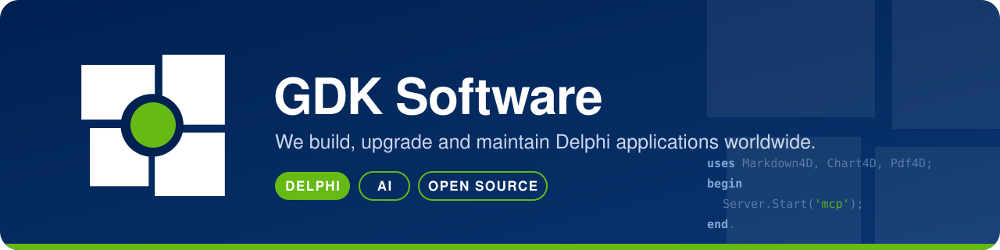
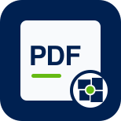
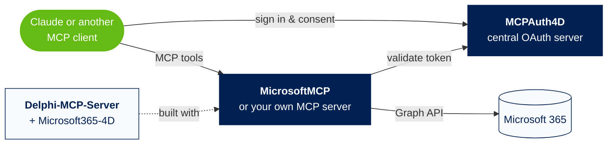
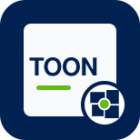
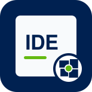
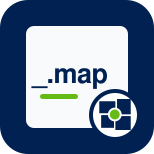
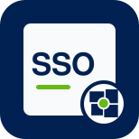
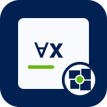

  

  
  

  GDK Software is dedicated to helping organizations succeed with their Delphi applications. 
  We work with a personal, no-nonsense approach and believe in long-term relationships 
  and sustainable, quality solutions.

## What we do

<table>
  <tr>
    <td width="50%" valign="top">🧱 <b>Delphi Development</b> Custom software solutions built with expertise</td>
    <td width="50%" valign="top">⬆️ <b>Application Upgrades</b> Modernizing legacy Delphi applications</td>
  </tr>
  <tr>
    <td valign="top">🧑‍💻 <b>Claude Code Training</b> Helping development teams work effectively with Claude Code</td>
    <td valign="top">🤖 <b>AI in Business Processes</b> Implementing AI in your business processes and connecting it to your systems</td>
  </tr>
  <tr>
    <td valign="top">🛟 <b>Maintenance &amp; Support</b> Keeping your applications running smoothly</td>
    <td valign="top">🔍 <b>Code Quality Assessment</b> Improving code maintainability and performance</td>
  </tr>
  <tr>
    <td valign="top">🏗️ <b>Architecture Improvement</b> Restructuring applications for better scalability</td>
    <td valign="top">🎓 <b>Developer Training</b> Sharing knowledge to empower your team</td>
  </tr>
</table>

## Open source

We actively contribute to the Delphi community. Our libraries are pure Delphi, with no external dependencies.

### 📚 Featured libraries

<table>
  <tr>
    <td width="33%" align="center" valign="top">
       
      <a href="https://github.com/GDKsoftware/Markdown4D"><b>Markdown4D</b></a> 
      CommonMark/GFM parser with a public AST, HTML renderer, markdown writer, and VCL &amp; FMX viewer and editor  
      
    </td>
    <td width="33%" align="center" valign="top">
       
      <a href="https://github.com/GDKsoftware/OfficeXML4D"><b>Office4D</b></a> 
      Read and write Word, Excel and PowerPoint documents without Microsoft Office  
      
    </td>
    <td width="33%" align="center" valign="top">
       
      <a href="https://github.com/GDKsoftware/Pdf4D"><b>Pdf4D</b></a> 
      Read PDF documents: pages, outlines, form fields, attachments and text extraction. A native port of Apache PDFBox
    </td>
  </tr>
  <tr>
    <td align="center" valign="top">
       
      <a href="https://github.com/GDKsoftware/Chart4D"><b>Chart4D</b></a> 
      Publication-ready charts for VCL and FMX with clean newspaper-style defaults and PNG export  
      
    </td>
    <td align="center" valign="top">
       
      <a href="https://github.com/GDKsoftware/Microsoft365-4D"><b>Microsoft365-4D</b></a> 
      Mail, Calendar, Contacts and SharePoint via the Graph API, with OAuth2 and PKCE  
      
    </td>
    <td align="center" valign="top">
       
      <a href="https://github.com/GDKsoftware/Javascript4D"><b>Javascript4D</b></a> 
      JavaScript parser and interpreter: ECMAScript 5.1 plus ES2015+ features such as classes, promises and generators  
      
    </td>
  </tr>
</table>

### 🤖 MCP & AI

Connect your Delphi applications and data to Claude and other AI assistants through the Model Context Protocol.

<table>
  <tr>
    <td width="25%" align="center" valign="top">
       
      <a href="https://github.com/GDKsoftware/Delphi-MCP-Server"><b>Delphi-MCP-Server</b></a> 
      Native Delphi implementation of the Model Context Protocol  
      
    </td>
    <td width="25%" align="center" valign="top">
       
      <a href="https://github.com/GDKsoftware/MCPAuth4D"><b>MCPAuth4D</b></a> 
      Central OAuth server and client with linked upstream accounts, so you can connect your Delphi MCP servers to Claude
    </td>
    <td width="25%" align="center" valign="top">
       
      <a href="https://github.com/GDKsoftware/MicrosoftMCP"><b>MicrosoftMCP</b></a> 
      Microsoft 365 MCP server with multiple mailboxes per user
    </td>
    <td width="25%" align="center" valign="top">
       
      <a href="https://github.com/GDKsoftware/Toon4D"><b>Toon4D</b></a> 
      JSON to TOON encoder: 30-60% token reduction for LLM prompts  
      
    </td>
  </tr>
</table>

### 🛠️ Developer tools and utilities

<table>
  <tr>
    <td width="48"></td>
    <td><a href="https://github.com/GDKsoftware/ToolsAPI-helper"><b>ToolsAPI-helper</b></a> Helpers and classes that make building your own Delphi IDE extensions with the ToolsAPI much easier</td>
  </tr>
  <tr>
    <td></td>
    <td><a href="https://github.com/GDKsoftware/Underscore4d"><b>Underscore4d</b></a> Functional programming utilities for Delphi</td>
  </tr>
  <tr>
    <td></td>
    <td><a href="https://github.com/GDKsoftware/firedac-threaded"><b>firedac-threaded</b></a> Thread-safe FireDAC database connections</td>
  </tr>
  <tr>
    <td></td>
    <td><a href="https://github.com/GDKsoftware/Windows-SSO"><b>Windows-SSO</b></a> Windows Single Sign-On authentication library</td>
  </tr>
  <tr>
    <td></td>
    <td><a href="https://github.com/GDKsoftware/Hypothesis4D"><b>Hypothesis4D</b></a> Property-based testing for Delphi, inspired by Python's Hypothesis</td>
  </tr>
</table>

## Contributing

We welcome contributions! **Report issues** when you find a bug, **submit pull requests** with improvements, **help with documentation**, or simply **star and share** our repositories.

Most of our open-source projects use the **MIT License**. Check each repository for its specific license.

## Work with us

> [!TIP]
> Need custom Delphi development, legacy modernization, code quality improvements, Claude Code training or AI in your business processes?
> We're here to help: **[info@gdksoftware.com](mailto:info@gdksoftware.com)** · **[gdksoftware.com](https://gdksoftware.com)**
